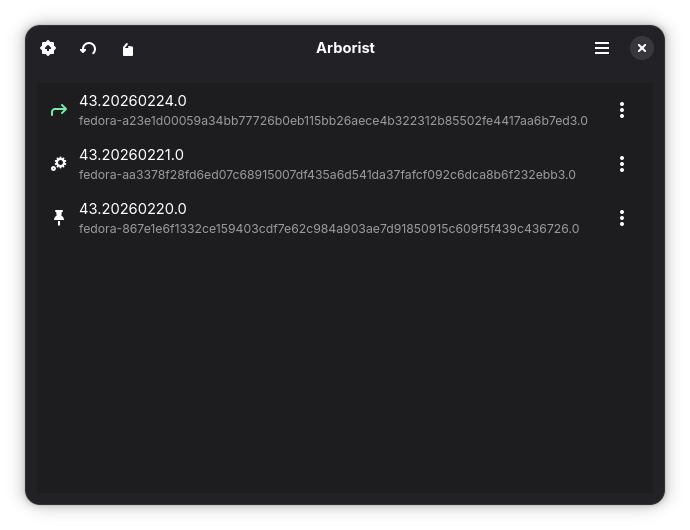

 
# Arborist
Manage your atomic deployments.


Arborist is a graphical utility to manage an atomic system. It provides an easy to use interface to help visualize and perform atomic transactions.

## Providers and Compatibility
Arborist was created with Fedora Silverblue and its derivatives in mind.

Currently, Arborist has support for these Atomic providers:
* rpm-ostree

## Installation
To install Arborist, download the RPM file in [Releases](https://github.com/jordanbrotherton/Arborist/releases/latest).
With the RPM file, install it with rpm-ostree:

`rpm-ostree install ./arborist-[version].fc[xx].noarch.rpm`

## Building
Arborist makes use of RPM to minimize dependencies and to allow access to the host system. Flatpak blocks the /run directory, which some Atomic providers require to run and monitor transactions. AppImage is no longer supported due to issues with modern Fedora versions.

Arborist needs these dependencies:

`rpmdevtools rpm-build meson ninja-build python3-devel gtk4-devel libadwaita-devel desktop-file-utils libappstream-glib`

To build Arborist into an RPM, simply run these commands in a Fedora Toolbox/Distrobox:

```
sudo dnf install rpmdevtools rpm-build meson ninja-build python3-devel gtk4-devel libadwaita-devel desktop-file-utils libappstream-glib
rpmdev-setuptree
git archive --format=tar.gz --prefix=arborist-1.0.0/ -o ~/rpmbuild/SOURCES/arborist-1.0.0.tar.gz HEAD
rpmbuild -ba arborist.spec
```
